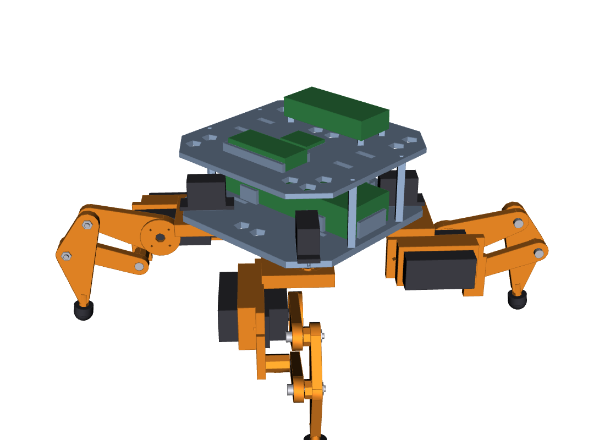
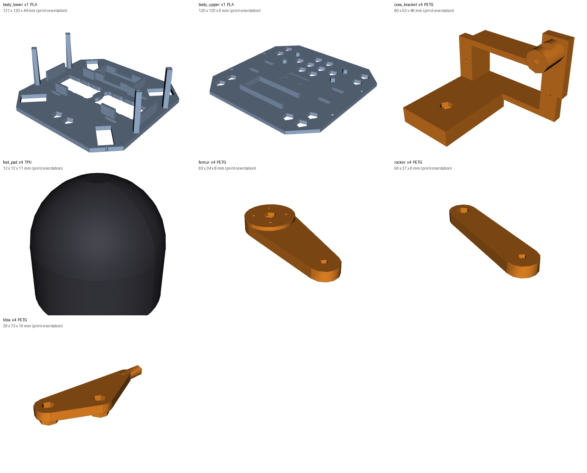
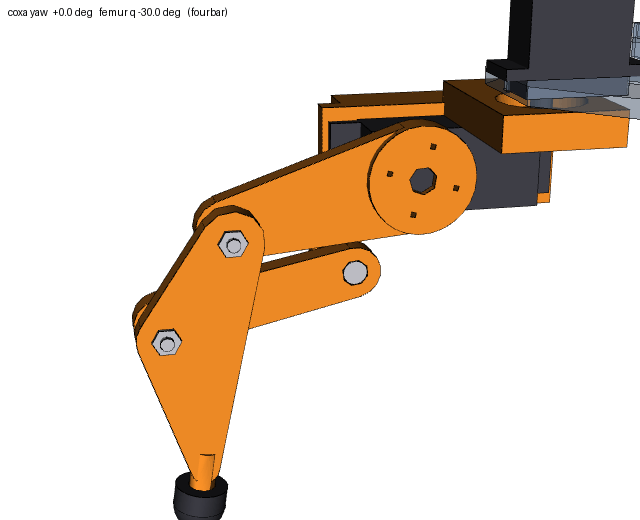
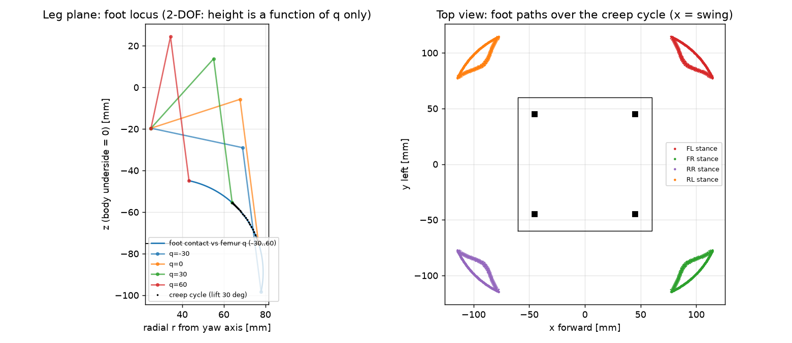

# Assembly and calibration

## Print settings (SPEC)
- PETG for legs and linkages (coxa_bracket, femur, rocker, tibia), PLA for the body (body_lower, body_upper), TPU or a rubber cap for foot_pad.
- Nozzle 0.4 mm, layer 0.2 mm, 4 perimeters on leg parts. Every part fits 220 x 220 x 250 mm.
- Exports are already in print orientation: `cad/out/*.stl` (STEP in `cad/out/*.step`). Quantities are in `BOM.md`.
- Tolerances built into the CAD: M3 clearance holes 3.3 mm, rotating pins +0.25 mm, nut traps 5.7 mm across flats (+0.2 mm), servo pockets +0.3 mm per side.
  Servo and board dimensions are UNVERIFIED dummies: measure your parts and adjust `cad/params.py` before printing the body.

## Order of work
1. **Print and build ONE test leg first** (coxa_bracket, femur, rocker, tibia, foot_pad, one MG90S + one MG996R). Check the pin joints turn
   freely, the four-bar keeps the tibia close to vertical, and the servo tabs fit.
2. Print the rest: 4 legs, body_lower, body_upper.
3. Fit the servos in the brackets, bolt the legs together with M3 + nylock nuts (tighten until just free).
4. Mount the lower body deck: battery, UBEC, fuse, switch. Upper deck: Nano, PCA9685, GY-521 (flat, +X forward, near the centre), 5 V buck + diode for the Nano.
5. Wire as in `WIRING.md`. Check polarity, set the UBEC to 6 V **before** connecting servos.
6. Upload `firmware/spider/spider.ino` (Arduino IDE or `arduino-cli compile/upload --fqbn arduino:megaavr:nona4809 firmware/spider`).
   No Adafruit library is needed (own PCA9685/MPU-6050 drivers).
7. Calibrate (below), then test with the robot on a stand (feet in the air) before putting it on the floor.

## Calibration (serial monitor, 115200 baud, newline)
The CAD assumes `servo_angle = 90 + sign * joint_angle` with sign +1: this is **unverified**, so direction and trim are per-servo values.
Joint zero: coxa 0 = leg along its diagonal heading, positive = counter-clockwise seen from above; femur 0 = femur 18 deg above horizontal,
positive = knee up (see `cad/out/leg_geometry.json`).

0. Power-up: the robot boots in the **sit pose**, enabling one leg every 300 ms (no snap to stand), and calibrates the gyro for 1 s: **keep it still
   and level at power-up**. Type `s` to ramp up to stand. Walking is refused while the IMU is missing or failing; after 10 failed reads in a row the
   robot prints a warning and sits.
1. Type `cal`. Servos **keep their current angles** (nothing snaps); move one servo at a time. `all90` is available but moves all of them at once.
2. Mount the horns so that each coxa points along its diagonal and each femur is about 18 deg above horizontal (foot on the neutral contact point).
3. For each servo: `sel <0-7>`, move it with `+`, `-` or `a <deg>` until the joint is exactly at zero, then `zero` stores `trim = angle - 90`
   (limited to +-30 deg; use the horn position for larger offsets).
4. Direction: command `a 100` and see whether coxa goes counter-clockwise / femur lifts the knee. If it moves the wrong way, `dir -1`.
5. Optionally narrow `min <deg>` / `max <deg>` to avoid mechanical collisions (defaults are the CAD limits: coxa 45-135, femur 60-150).
6. `save` writes everything to EEPROM (restored at boot); `exit` leaves calibration mode.

## Commands
`f` forward, `b` back, `l` / `r` turn left/right, `s` stand, `x` sit, `gait creep|trot`, `clear` (after a fall; then `s`), `release on|off` (servos go limp 1.5 s after a fall), `stat`.
Creep: duty 0.75, 2.5 s cycle. Trot: duty 0.5, 1.0 s cycle (start with creep).
Fall detection: tilt above 30 deg (complementary filter on the MPU-6050) stops the gait and sits; `clear` then `s` resumes.

## Safety
LiPo: use a low-voltage alarm and the fuse; never short the pack. Keep fingers clear of the legs during the first power-up.
