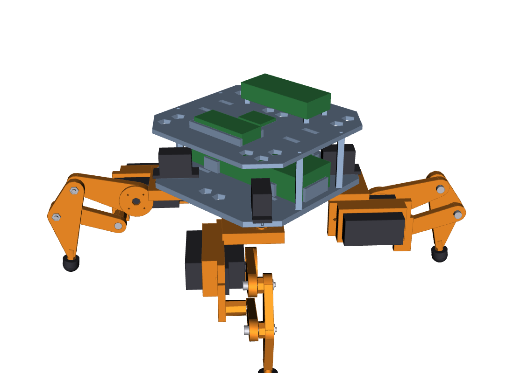
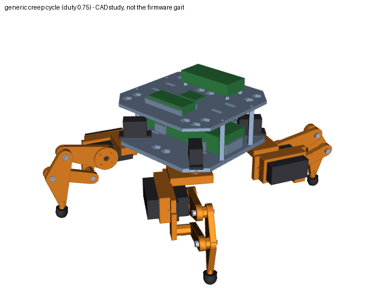

# spider-robot
4-legged, 8-servo 3D-printed spider robot: Arduino Nano Every + PCA9685 + MPU-6050 (GY-521), 2S LiPo + 6 V UBEC.
Coxa yaw = MG90S, femur lift = MG996R, passive parallelogram four-bar tibia (fixed-bent-tibia fallback flag).
CAD in CadQuery (`cad/`), firmware in `firmware/` (geometry generated from `cad/out/leg_geometry.json`).
Docs: [BOM.md](BOM.md), [WIRING.md](WIRING.md), [ASSEMBLY.md](ASSEMBLY.md).

## Commands
    tools/run_tests.sh                 # THE test command: CAD build + checks, firmware header check, host unit tests, mutation
                                       # self-tests, arduino-cli compile (if installed); exits non-zero on any failure
    python3 tools/gen_geometry_header.py   # regenerate firmware/spider/src/geometry_gen.h after the CAD JSON changes
    ~/tools/cad-venv/bin/python cad/build_all.py           # STEP/STL (print orientation) + leg_geometry.json -> cad/out/
    ~/tools/cad-venv/bin/python cad/make_renders.py        # iso.png, parts_sheet.png, leg_motion.gif, gait.gif, foot_path.png
    SPIDER_TIBIA_MODE=fixed ...                            # fixed-bent-tibia fallback (outputs in cad/out/fixed/)

## Layout
- `cad/params.py`   every dimension (SPEC values, tolerances, servo envelopes, BOM masses, analysis limits)
- `cad/kin.py`      leg kinematics (four-bar solver) + derived geometry; `cad/gait.py` generic creep cycle for the studies
- `cad/parts.py`    CadQuery part builders; `cad/assembly.py` posed assembly; `cad/render.py`, `cad/make_renders.py`
- `cad/analysis/`   check_*.py (each prints PASS/FAIL, exit 1 on fail)
- `cad/out/`        exports + renders + `leg_geometry.json`

## Printed parts (qty)
body_lower (1, PLA), body_upper (1, PLA), coxa_bracket (4, PETG), femur (4), rocker (4), tibia (4) (PETG), foot_pad (4, TPU).
Servo/board envelopes are dummies from commonly published dimensions: UNVERIFIED, measure the real parts before printing
(MG996R tab hole spacing, horn bolt patterns, GY-521 holes, PCA9685 holes). Print one test leg first.

## Firmware (`firmware/spider/`, Arduino Nano Every)
- `src/` pure C++ (no Arduino deps, host-tested): `kinematics` (four-bar table FK/IK, workspace clamp), `gait` (creep duty 0.75 / 2.5 s with
  coxa-only weight shift, trot duty 0.5 / 1.0 s, Robot controller), `servo` (direction/trim/limits), `imu_filter` (complementary filter, fall detect > 30 deg).
- `spider.ino`, `pca9685.h`, `mpu6050.h`, `storage.h`: Arduino layer (own I2C drivers, EEPROM calibration, serial commands + calibration mode).
- Tests: `firmware/tests/test_spider.cpp` (`g++`), run by `tools/firmware_tests.sh`.
- Not verified on hardware: servo signs/trims, gait tuning. Compile for the Nano Every needs `arduino-cli` (reported as NOT VERIFIED when missing).
